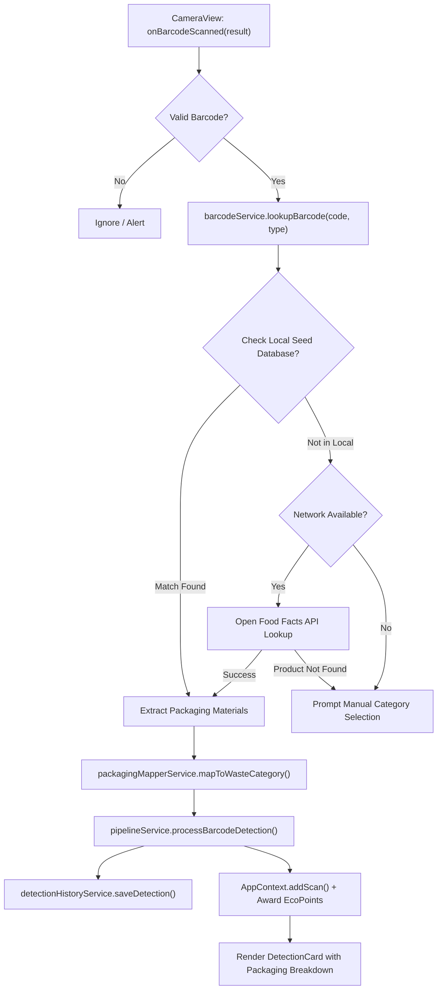

# Milestone 12: Implementation Plan — AI and Barcode Identification Completion

**Project:** EcoSnap & Segregate  
**Role:** Senior React Native, Expo, TypeScript & AI Integration Engineer  
**Scope:** Member 2 Implementation Plan  
**Target Completion:** Milestone 12 Completion  
**Status:** Plan Proposed — Awaiting Approval  

---

## 1. Plan Overview & Objectives

The primary goal of Milestone 12 is to complete Member 2's AI and mobile-intelligence features without disrupting existing architecture or rewriting working modules. 

Specifically, this plan addresses:
1. Transforming the barcode scanner from an alert stub into a full product-lookup and packaging-to-waste classification pipeline.
2. Establishing a dual offline/online barcode database architecture to safeguard offline-first operation.
3. Hardening the AI model loading and preprocessing lifecycle against missing model assets and runtime failures.
4. Hardening data persistence across all gamification services using self-healing storage utilities.
5. Shielding the mobile application from crashing when Member 1's Firebase environment variables are unconfigured.
6. Expanding automated unit test coverage across all Member 2 services.

---

## 2. Architecture & Design Specifications

### 2.1 Barcode Identification & Product Lookup Architecture



#### Key Components:
- **`mobile-app/src/services/barcode/barcodeService.ts`**:
  - Encapsulates barcode queries.
  - Queries a bundled offline seed database of common barcodes (`assets/data/barcode_seed_products.json`) containing consumer items (soda cans, water bottles, milk cartons, cereal boxes, electronics).
  - Falls back to `https://world.openfoodfacts.org/api/v2/product/{barcode}.json` when online.
  - Gracefully falls back to manual classification if unlisted or offline.
- **`mobile-app/src/services/barcode/packagingMapperService.ts`**:
  - Parses packaging text strings (e.g. "plastic bottle", "aluminium can", "tetra pak", "glass jar", "cardboard box").
  - Maps packaging components to target `WasteCategory` (Plastic, Paper, Glass, Metal, Organic, E-Waste).
  - Handles multi-material items (e.g., plastic bottle with aluminum cap) with prioritized recommendations.

---

### 2.2 Integration with Unified AI Pipeline (`pipelineService.ts`)

Extend `pipelineService` with a new method `processBarcode(barcodeResult: BarcodeScanningResult)`:
1. Calls `barcodeService.lookupBarcode(data)`.
2. Resolves primary and secondary waste categories using `packagingMapperService`.
3. Constructs a standardized `DetectionResponse` (metadata indicates `source: 'barcode'`).
4. Generates a canonical `WasteItem` awarding points via `calculateScore()`.
5. Persists the detection into `detectionHistoryService`.
6. Returns normalized result to `CameraScreen.tsx` to display `DetectionCard` with disposal steps and bin instructions.

---

### 2.3 Model Loader & TFLite Hardening

- **Missing Asset Defense:**
  - In `modelLoader.ts`, catch asset resolution failures.
  - Provide a mock/fallback classification provider when running in an environment without physical `.tflite` model compilation (e.g. Expo Go, simulators, or local dev without compiled native JSI).
  - Bundle a placeholder/fallback model file or safe stub to prevent Metro bundling errors.
- **Preprocessing Alignment:**
  - Verify `imagePreprocessor.ts` tensor shapes and data types.
  - Add explicit bounds checking and error handling during `jpeg-js` decoding.

---

### 2.4 Persistence & Self-Healing Hardening

- Update `EcoPointsService.ts`, `BadgeService.ts`, `ChallengeService.ts`, and `GoalService.ts` to utilize `safeFileSystemRead` from `safeStorage.ts`.
- When reading JSON files from `FileSystem.documentDirectory`, corrupted content will automatically reset to safe defaults without crashing the dashboard.
- In `DetectionHistoryService.ts`, copy temporary camera images from `FileSystem.cacheDirectory` to a persistent folder in `FileSystem.documentDirectory + 'images/'` so historical scan images remain visible indefinitely.

---

### 2.5 Member 1 Integration & Graceful Firebase Degradation

- Modify `mobile-app/src/services/firebase/firebaseConfig.ts`:
  - Instead of throwing a fatal `new Error()` at top-level module evaluation when environment variables are missing, log a warning and export safe stub instances or a flag `isFirebaseInitialized: false`.
  - In `AuthContext.tsx`, check `isFirebaseInitialized`. If unconfigured, initialize in offline Guest Mode with mock user session without throwing.
  - This allows the app to run completely offline without crashing, while seamlessly switching to live Firebase when Member 1's `.env` is supplied.

---

### 2.6 Comprehensive Test Expansion

Create dedicated Jest test suites:
1. `mobile-app/src/services/barcode/__tests__/barcodeService.test.ts`
2. `mobile-app/src/services/barcode/__tests__/packagingMapperService.test.ts`
3. `mobile-app/src/services/ai/__tests__/detectionService.test.ts`
4. `mobile-app/src/services/ai/__tests__/recommendationService.test.ts`
5. `mobile-app/src/services/ai/__tests__/analyticsService.test.ts`
6. `mobile-app/src/services/history/__tests__/DetectionHistoryService.test.ts`
7. `mobile-app/src/services/points/__tests__/EcoPointsService.test.ts`
8. `mobile-app/src/utils/__tests__/safeStorage.test.ts`

---

## 3. Phased Implementation Sequence

```text
Phase 1: Barcode & Packaging Identification Engine
  ├── Create barcode_seed_products.json (offline lookup database)
  ├── Implement packagingMapperService.ts (packaging to WasteCategory mapping)
  └── Implement barcodeService.ts (offline-first lookup with online fallback)

Phase 2: Pipeline & UI Integration
  ├── Extend pipelineService.ts to support processBarcode()
  ├── Update CameraScreen.tsx handleBarcodeScanned to trigger pipelineService
  └── Render DetectionCard with packaging details and disposal guidance

Phase 3: AI Engine & Model Loader Hardening
  ├── Guard modelLoader.ts against missing .tflite files with resilient fallback
  └── Validate imagePreprocessor.ts input guards and error boundaries

Phase 4: Persistence Hardening & Image Durability
  ├── Convert EcoPointsService, BadgeService, ChallengeService, GoalService to safeFileSystemRead
  └── Implement persistent image caching in DetectionHistoryService

Phase 5: Member 1 Integration Boundary & Firebase Resilience
  ├── Refactor firebaseConfig.ts to prevent hard crashes on missing .env
  └── Update AuthContext.tsx to support graceful offline guest fallback

Phase 6: Comprehensive Unit Test Suite Expansion
  ├── Write unit tests for barcodeService & packagingMapperService
  ├── Write unit tests for detectionService, recommendationService, analyticsService
  ├── Write unit tests for safeStorage and history persistence
  └── Verify full test suite passes with npm test and tsc --noEmit
```

---

## 4. Technical Risks & Mitigation

| Risk | Impact | Mitigation Strategy |
|---|---|---|
| **No Internet for Barcode Scan** | High | Bundle a local `barcode_seed_products.json` database containing common packaging types; provide clean manual fallback UI when barcode is unlisted. |
| **Missing .tflite Binary** | High | Implement fallback classifier in `modelLoader.ts` that triggers when the binary asset cannot be resolved natively. |
| **Firebase Crash on Launch** | Critical | Replace top-level fatal throw in `firebaseConfig.ts` with graceful initialization flag. |
| **UI Freezing on Large Images** | Medium | Maintain 224×224 resize via `expo-image-manipulator` prior to JS thread pixel manipulation. |
| **Breaking Existing Tests** | Low | Preserve all existing method signatures in `pipelineService` and `wasteAnalytics`. |

---

## 5. Rollback Strategy

1. All new barcode and packaging modules are isolated under `src/services/barcode/`.
2. Existing camera AI flows remain unaltered; barcode processing is an additive pipeline path.
3. If native TFLite compilation exhibits issues on target hardware, the fallback classifier can be toggled via `appConfig.ts` without codebase refactoring.
